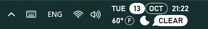

# Micrographics Taskbar Clock

A [Windhawk](https://windhawk.net/) mod that replaces the Windows 11 taskbar
clock with a clock face inspired by the "Micrographics" clock of Nothing OS 5.

* Weekday, day of month in a filled pill, month in an outlined pill, the time
  and a blinking block cursor.
* Temperature, an abstract weather icon and the current conditions in a speech
  bubble.
* Follows the taskbar's light/dark text color automatically, on every monitor.
* Clicking the clock still opens the notification center and calendar.

## Install

Search for **Micrographics Taskbar Clock** in Windhawk's Explore tab once it's
available in the official catalog.

To try the latest source before that:

1. In Windhawk, click **Create a New Mod**.
2. Replace the template with the contents of
   [`micrographics-taskbar-clock.wh.cpp`](micrographics-taskbar-clock.wh.cpp).
3. Click **Compile Mod**, then **Exit Editing Mode**.

## Settings

| Setting | Default | Notes |
|---|---|---|
| Layout | Two rows | Or everything on one row. |
| Row alignment | Left | Left, center or right. |
| Font family | Bahnschrift | Any installed font, e.g. Cascadia Mono. |
| Font weight | Medium | Normal, medium, semi bold or bold. |
| Font size | 13 | Shrinks automatically to fit the taskbar height. |
| 24-hour time | On | |
| Show seconds | Off | |
| Block cursor | Blinking | Blinking, always visible or hidden. |
| Text color | Taskbar's | `#RRGGBB` or `#AARRGGBB`. |
| Pill color | Text color | E.g. `#D71921` for Nothing red. |
| Weather | On | |
| Location | Auto | A city name or `latitude,longitude`. |
| Fahrenheit | Off | |
| Update interval | 15 minutes | |

## Weather and privacy

Weather comes from [Open-Meteo](https://open-meteo.com/) (free, no API key).
If the location setting is empty, it's approximated from your public IP address
using [ipwho.is](https://ipwho.is/), or [GeoJS](https://www.geojs.io/) if that
fails. Set a location to skip that lookup, or turn the weather off and the mod
makes no network requests at all.

## Compatibility

Windows 11 with the XAML taskbar, 64-bit. Developed on build 26300 with
Windhawk 1.7.3.

## Design mock

[`preview/mock.html`](preview/mock.html) is a browser mock of the clock face,
handy for trying out proportions and icon shapes. Serve it with
`node preview/serve.js` and open http://localhost:4173.

## License

[MIT](LICENSE)
